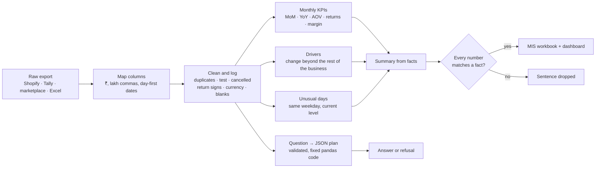

# ClearMIS


**Your monthly MIS from a raw sales export, in minutes: cleaned, explained, and every number checked.**

Upload a Shopify, Tally, marketplace or Excel export. ClearMIS fixes what raw exports get wrong (repeated rows, test and cancelled orders, returns booked as sales, other currencies), then writes the month's MIS: KPIs, month-on-month and year-on-year change, **what drove the change**, unusual days, and a data-fix log. The written summary is checked number by number against the computed results, so it cannot invent a figure. Questions in plain English are answered without ever running AI-written code.

## Results

`python -m clearmis.evaluate` builds 15 months of orders for a D2C brand with planted truth: one real driver every month, unusual days, and the junk real exports contain. The **held-out** set arrives as a Shopify export with ₹ amounts, lakh commas and day-first dates, with different sizes, noise and weekday pattern, and was never used for tuning. CI fails if revenue is off, a driver is missed or an unverified number appears.

| | Dev (generic export) | Held-out (Shopify, ₹, day-first dates) |
|---|---|---|
| Rows in the raw export | 81,274 | 106,635 |
| Monthly revenue error: raw export summed | 10.05% | 13.72% |
| Monthly revenue error: **ClearMIS** | **0.0%** | **0.0%** |
| Monthly orders error: raw / ClearMIS | 4.72% / 0.0% | 4.11% / 0.0% |
| Right reason for the monthly change: biggest change | 4/6 | 6/6 |
| Right reason for the monthly change: **ClearMIS** | **6/6** | **6/6** |
| Unusual days, 3-sigma rule: correct / flagged / planted | 5 / 8 / 10 | 6 / 7 / 8 |
| Unusual days, **ClearMIS**: correct / flagged / planted | **10 / 11 / 10** | **8 / 11 / 8** |
| Summary numbers verified against results | 125/125 | 111/111 |
| Altered numbers caught by the checker | 123/124 | 106/111 |
| Questions answered right, no LLM (dev / new wording) | 22/22 | 14/22 |

Every one of 8 planted data problems was found with the exact row count in both sets: duplicate rows (1,178 / 1,545), cancelled orders, test orders, returns booked as positive, other currencies, future dates, missing amounts and blank regions.

**What the numbers say:** summing a raw export overstates monthly revenue, by up to 10% on dev data and 14% on held-out. ClearMIS matches the true ledger exactly. It names the right driver every month; the simple "biggest change" view is fooled when the whole business moves (dev: 4/6). On new wording the keyword planner answers 14 of 22 and refuses the rest rather than guessing; connecting an LLM (below) handles free-form questions, still without running code.

## Who buys it and how it is sold

| | |
|---|---|
| **Buyers** | CA firms and accountants preparing monthly MIS for many clients; D2C brands, distributors and retail chains; finance teams in SMEs |
| **Their pain** | MIS takes days of Excel every month; totals from raw exports are quietly wrong; "why did sales drop?" needs a pivot marathon; general AI chat tools invent numbers and need sensitive data pasted into them |
| **What they get** | The MIS workbook (summary, KPIs, drivers, unusual days, data fixes, clean ledger) in minutes, an explanation of the change, a log of every correction, and plain-English questions answered from the data |
| **Trust** | Every summary number is verified; questions become a checked query plan, never executed code; runs on the client's own machine or cloud |
| **India ready** | ₹ in lakh and crore, Indian number formats, day-first dates, Tally sales register and Shopify column names |

**ROI example** (illustrative, use your own numbers): a CA firm preparing MIS for 20 clients at 2 staff-days each per month, at ₹4,000 per staff-day, spends **₹1.6 lakh a month**. If ClearMIS turns each MIS into a 1-hour review, most of that time goes back to advisory work, and the 10%+ errors from raw exports never reach a client.

| Plan (suggested) | For | Price idea |
|---|---|---|
| Business | One company | ₹1,999 per month |
| Practice | CA firms and consultants | ₹9,999 per month for up to 15 client companies |
| Enterprise | Groups, chains | Annual licence, on-premise, custom KPIs and targets |

**Pilot plan (2 weeks):** take the client's last 3 months of exports and the MIS they already prepared by hand. ClearMIS rebuilds those months; every difference is explained line by line (duplicates, returns, cancellations). The client sees the time saved and the errors caught on their own data before paying.

## How it works



| Design choice | Why |
|---|---|
| No generated code is ever executed | The old version ran whatever the model wrote with full system access; a CSV cell or a question could become a command |
| Questions become a validated plan | Metric, breakdown, filters and months are checked against real columns and values; unknown names are refused, not silently ignored |
| Summary built from facts, then verified | Each number must match a computed fact of the same kind (money, %, count, year) within its shown rounding; an LLM may rephrase but cannot add figures |
| Drivers measured against the rest of the business | When everything grows 10%, the largest region "grows most" in rupees; what matters is who moved differently |
| Unusual days judged against the same weekday at the current level | Weekends and festive build-ups are normal; a ₹0 Tuesday is not |
| Every correction is logged with rows and value | A finance team must be able to explain each difference from the raw export |

## Use it

```bash
pip install -e ".[app]" && streamlit run app.py        # dashboard; runs on a sample if no file
pip install -e .
clearmis demo --out sample_sales.csv                   # a 6-month Shopify-style sample export
clearmis report sample_sales.csv --out mis.xlsx        # MIS workbook for the latest complete month
clearmis ask sample_sales.csv "revenue by region last month"
docker compose up -d                                   # API :8000 + dashboard :8501
```

| Endpoint | What it does |
|---|---|
| `POST /v1/reports` | Upload a CSV or Excel export (`file`), optional `month`; returns the MIS as JSON and an id |
| `GET /v1/reports/{id}/xlsx` | The MIS workbook |
| `POST /v1/reports/{id}/ask` | `{"question": "top 3 products by revenue in May 2026"}` → answer, the plan used, values |

**Optional LLM** (`CLEARMIS_LLM=groq` with `GROQ_API_KEY`, or gemini, openrouter, local ollama): writes the query plan for free-form questions and rephrases the summary. Its plan is validated like any other, and any rephrased sentence with a number that is not a fact is dropped.

## Limitations

- The benchmark is synthetic: real ledgers cannot be published with ground truth. The pilot is how a client validates it on their own data.
- Without an LLM, questions must use common wording (14 of 22 new phrasings answered, the rest refused). The LLM planner is not scored in CI because it needs an API key.
- The checker cannot catch an altered number that happens to equal another true figure in the same summary, or a change smaller than the shown rounding (₹12.4 lakh hides anything under ₹5,000).
- Other currencies are excluded unless exchange rates are given. No GST or tax computation; InvoiceIQ covers GST reconciliation.
- Column mapping covers common export names; unusual layouts need a one-time mapping.

## Project layout

```
src/clearmis/ingest.py     column mapping (Shopify, Tally, marketplaces, generic), Indian formats
src/clearmis/quality.py    cleaning with a log of every fix
src/clearmis/analysis.py   monthly KPIs, drivers beyond trend, unusual days
src/clearmis/narrative.py  summary from facts, ₹ lakh/crore, number verification
src/clearmis/ask.py        question -> validated plan -> fixed pandas code (no exec)
src/clearmis/llm.py        optional OpenAI-compatible LLM for plans and rephrasing
src/clearmis/report.py     one call from export to MIS, Excel workbook
src/clearmis/synth.py      D2C ledger with planted drivers, unusual days and junk
src/clearmis/evaluate.py   benchmark vs raw totals, biggest change, 3-sigma; CI gate
src/clearmis/api.py        FastAPI service
app.py                     Streamlit dashboard
```
